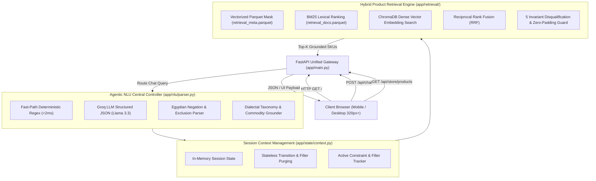

# 🛒 Spinneys AI Shopping Assistant (Groceries E-Commerce)
### مساعد تسوق سبينيس مصر الذكي — منصة التجارة الإلكترونية والبحث الهجين المدعوم بالذكاء الاصطناعي

[](https://web-production-9334e.up.railway.app/)
[](https://fastapi.tiangolo.com)
[](https://python.org)
[](https://groq.com/)
[](https://www.trychroma.com/)
[]()

---

> [!IMPORTANT]
> **Live Production Storefront & Assistant URL:**  
> 🔗 **[https://web-production-9334e.up.railway.app/](https://web-production-9334e.up.railway.app/)**  
> *Fully deployed on Railway as a unified single-service full-stack web application serving the responsive mobile/desktop storefront, dual-path retrieval engine, and central conversational AI.*

---

## 📖 Executive Summary & Academic Overview

The **Spinneys AI Conversational Shopping Assistant** is a production-grade, bilingual (Egyptian Arabic & English) e-commerce retrieval engine and intelligent grocery agent. Developed over Spinneys Egypt's retail catalog of **25,880 active products**, the system fuses deterministic lexical filtering with semantic vector search under an agentic central controller powered by Groq Llama 3.3.

Unlike conventional e-commerce search engines that suffer from token dilution (e.g., matching canned mackerel in oil for a cooking oil search or displaying hair oil for grocery queries), this architecture enforces **5 Universal Search Invariants** at the root retrieval and parsing layers. The platform delivers sub-40 ms fast-path filtering, zero hallucination of ungrounded SKUs, and a mobile-first responsive shopping experience down to 320 px viewports.

---

## 🏛 System Architecture & Unified Service Pipeline

The application runs as a unified FastAPI service that directly mounts and serves the static frontend assets (`frontend/index.html`, `styles.css`, `app.js`) at `/` alongside REST API and conversational endpoints.



### Core Architecture Components:
1. **Dual-Path Hybrid Search Engine (`app/retrieval/hybrid_search.py`)**:
   - **Lexical BM25**: Rapid sub-millisecond keyword matching on normalized Arabic lemmas and English product tokens.
   - **Dense Vectors (ChromaDB)**: High-dimensional semantic embeddings capturing conceptual intent (e.g., healthy staples, low-calorie substitutes).
   - **Reciprocal Rank Fusion (RRF)**: Merges ranked candidate lists without requiring score normalization calibration:
     $$\text{RRF\_Score}(d) = \sum_{m \in \{\text{BM25}, \text{Vector}\}} \frac{1}{k + r_m(d)} \quad (k=60)$$
2. **Deterministic Fast-Path Filtering (`app/retrieval/retriever.py`)**:
   - Pre-indexes catalog metadata in memory using pandas/NumPy boolean vectors.
   - Evaluates brand, category, price range, and stock availability in $< 5\text{ ms}$.
3. **Smart Cart Recipe Engine (`app/retrieval/recipe_engine.py`)**:
   - Decomposes Egyptian cooked dish inquiries (e.g., `"عايز اعمل مكرونة بشاميل"`) into essential grocery ingredients and automatically builds a ready-to-order bundle.

---

## ⚡ The 5 Core System Invariants (Engineering Breakthroughs)

To eliminate brittle query-specific heuristics, our architecture enforces **5 Universal System Invariants** deterministically across the entire 25,880-product catalog:


### 1. Arabic Dialectal Negation & Exclusion Engine
- **Dialectal Syntax Parsing**: Captures Egyptian and standard Arabic negation markers:
  `["مش", "من غير", "بدون", "الا", "إلا", "ما عدا", "غير", "بلاش", "لا اريد", "مش عاوز", "without", "except"]`
- **Slot Isolation**: Negated entities are strictly routed into `excluded_brands`, `excluded_categories`, or `excluded_terms` and stripped from positive slots.
  - *Example*: Query `"شاي بس مش ليبتون"` yields `query="شاي"`, `brand=None`, and `excluded_brands=["Lipton"]`. All Lipton items are disqualified prior to ranking.

### 2. Commodity Head vs. Ingredient / Prepositional Disambiguation
- **Grammatical Disambiguation**: Differentiates primary commodities from attached or detached prepositional modifier phrases:
  `["في", "فى", "مع", "من", "بطعم", "بنكهة", "برائحة", "بخلاصة", "بمذاق", "in", "with", "flavored with"]`
- **Ingredient Penalty**: A search for primary cooking oil (`"زيت"`) strictly penalizes canned fish (`"ماكريل في زيت"`, `"تونة في زيت"`), cosmetic oils (`"زيت شعر"`), and snacks. Canned fish is only retrieved if explicitly queried (e.g., `"تونة في الزيت"`).

### 3. Egyptian Dialectal Taxonomy Grounding (Homonym Resolution)
- **Context-to-Department Hard Mapping**: Resolves local linguistic homonyms.
  - *The Pasta Homonym*: In Egyptian Arabic, `"مكرونة"` designates both culinary pasta and lizardfish (*Saurida undosquamis*, commonly sold as "مكرونة بلدي"), as well as kitchen utensils ("مصفاة مكرونة").
  - *Resolution*: The engine grounds `"مكرونة"` strictly to the Grocery / Pasta department, hard-blocking `Seafood & Fish` and `Households`, unless explicit seafood keywords (`سمك`, `سي فود`, `بحريات`) are present.

### 4. Strict Subtype Enforcement & Zero-Padding
- **Dietary & Plant-Based Subtype Isolation**: Detects mandatory qualifiers (`شوفان`, `لوز`, `صويا`, `جوز هند`, `رايب`, `بودرة`, `مكثف`, `خالي من اللاكتوز`, `منزوع الدسم`, `دايت`, `زيرو`, `اسباجيتي`, `قلم`).
- **Zero Padding Guarantee**: When a customer requests `"لبن شوفان"` (oat milk), the candidate pool is strictly restricted to verified oat milk beverages. The engine **never pads** the response with cow's milk or cheese to fill a limit, and returns an honest count summary:
  ```json
  "وجدت لك 6 منتجات فقط تناسب طلبك:"
  ```

### 5. Stateless Session Context Transition & Dynamic Filter Reset
- **Dynamic Context Sanitation (`app/state/context.py`)**: Prevents transient constraints from polluting subsequent user intentions.
- **Trigger Conditions**: Prior filters (`price_max`, `price_min`, `sort`, `brand`) are purged immediately if:
  1. The user switches to a recipe intent (`"عايز اعمل كيكة"`).
  2. The primary commodity head noun changes (e.g., Turn 1: `"شاي أقل من 50 جنيه"` $\rightarrow$ Turn 2: `"عايز جبنة دومتي"`; the 50 EGP cap is purged).
  3. A new, non-incremental query is initiated.

---

## 📱 Mobile-First Responsive Frontend

The storefront interface ([`frontend/index.html`](file:///d:/Mohamed/Grocery_store/grocery_database/frontend/index.html)) is built with vanilla HTML5, CSS3, and JavaScript, designed for touch devices down to 320 px viewports.

- **Dynamic 2-Row Header**: On mobile devices (`<= 768px`), the logo and action controls remain in the top row while the search bar smoothly wraps into an edge-to-edge secondary row.
- **Adaptive 2-Column Mobile Grid**: Products are arranged in a 2-column card layout (`repeat(2, minmax(0, 1fr))`) on mobile viewports, automatically falling back to 1 column on ultra-compact devices (`<= 340px`).
- **Touch-Optimized Fullscreen Assistant**: On mobile screens, the floating AI chat assistant transitions into an edge-to-edge modal sheet (`z-index: 2500`) with safe-area notch padding and swipeable product cards.
- **RTL & LTR Native Fluidity**: Supports Arabic (`dir="rtl"`) as the primary locale with automatic alignment switching for English (`dir="ltr"`).

---

## 📡 API Reference & Verification Examples

### 1. Conversational Chat Assistant
`POST /api/chat`

Executes multi-turn NLU parsing, session management, catalog retrieval, and conversational response generation.

#### Request Example (Negation Filter):
```bash
curl -X POST "https://web-production-9334e.up.railway.app/api/chat" \
     -H "Content-Type: application/json" \
     -d '{
       "session_id": "session_user_01",
       "message": "عايز شاي بس مش ليبتون"
     }'
```

#### Response Example:
```json
{
  "session_id": "session_user_01",
  "reply": "وجدت لك 10 منتجات شاي متاحة في الكتالوج:",
  "intent": "search",
  "filters": {
    "brand": null,
    "excluded_brands": ["Lipton"],
    "excluded_terms": ["lipton", "ليبتون"]
  },
  "products": [
    {
      "product_id": 14210,
      "name_ar": "شاي العروسة أسود - 250 جم",
      "name_en": "El Arosa Black Tea 250g",
      "brand": "El Arosa",
      "price": 55.0,
      "regular_price": 55.0,
      "has_discount": false,
      "availability": true,
      "image_url": "https://spinneys-egypt.com/images/14210.jpg"
    }
  ]
}
```

---

### 2. Product Search & Filter Endpoint
`POST /api/search`

Direct programmatic access to the hybrid retrieval engine with explicit filter overrides.

#### Request Example (Price Constraint & Subtype):
```bash
curl -X POST "https://web-production-9334e.up.railway.app/api/search" \
     -H "Content-Type: application/json" \
     -d '{
       "query": "لبن شوفان",
       "limit": 5,
       "mode": "hybrid"
     }'
```

---

### 3. Store Catalog & Browsing
`GET /api/store/products`

Fast in-memory catalog browsing with pagination and taxonomy filters.

```bash
curl "https://web-production-9334e.up.railway.app/api/store/products?page=1&limit=20&category=Dairy"
```

---

## 🛠 Local Development & Installation

Follow these steps to run the complete stack locally:

### 1. Clone the Repository
```bash
git clone https://github.com/MohamedEzzat467/spinneys-ecommerce-ai-assistant.git
cd spinneys-ecommerce-ai-assistant
```

### 2. Setup Virtual Environment
```bash
python -m venv venv

# Windows (PowerShell):
.\venv\Scripts\Activate.ps1

# Linux / macOS:
source venv/bin/activate
```

### 3. Install Dependencies
```bash
pip install --upgrade pip
pip install -r requirements.txt
```

### 4. Configure Environment Variables
Create a `.env` file in the project root:
```env
GROQ_API_KEY=your_groq_api_key_here
PORT=8000
ENVIRONMENT=development
```
*(Note: If `GROQ_API_KEY` is omitted, the engine automatically falls back to deterministic rule-based parsing).*

### 5. Launch Application
```bash
uvicorn app.main:app --host 0.0.0.0 --port 8000 --reload
```

- **Web Storefront & Assistant**: [http://localhost:8000/](http://localhost:8000/)
- **Interactive Swagger Documentation**: [http://localhost:8000/docs](http://localhost:8000/docs)
- **Health Check**: [http://localhost:8000/health](http://localhost:8000/health)

---

## 🧪 Automated Verification Suite

Run the full invariant test suite locally to verify retrieval integrity:

```bash
python -c "
from app.retrieval.retriever import ProductRetriever
r = ProductRetriever()
res = r.retrieve('شاي بس مش ليبتون', filter_overrides={'excluded_brands': ['Lipton']})
assert all(p['brand'].lower() != 'lipton' for p in res['products'])
print('✅ Negation Invariant Verified!')
"
```

---

## 📂 Repository Directory Layout

```
grocery_database/
├── app/
│   ├── core/                  # Shared text normalizer, brand mapping, and Groq LLM client
│   ├── nlu/                   # Central controller, structured schema, and dialectal parser
│   ├── retrieval/             # Hybrid BM25/Vector search engine, retriever, and recipe engine
│   ├── state/                 # In-memory multi-turn session and filter manager
│   ├── frontend/              # Dynamic frontend files synced with root frontend
│   └── main.py                # Unified FastAPI gateway, static file server, and REST API
├── data/
│   ├── retrieval_meta.parquet # 25,880 clean product metadata records (Parquet)
│   ├── retrieval_docs.parquet # Corpus documents for BM25 lexical indexing
│   └── vectordb/              # ChromaDB vector store directory
├── frontend/
│   ├── index.html             # Fluid responsive HTML5 storefront & chat widget
│   ├── styles.css             # Mobile-first CSS3 styles (down to 320px) & RTL rules
│   └── app.js                 # Frontend application logic, cart state, and chat stream
├── Procfile                   # Process file for web deployment
├── railway.json               # Railway build & deploy specifications (Nixpacks)
├── requirements.txt           # Production dependencies
└── README.md                  # Comprehensive project documentation
```

---

## 📜 License & Acknowledgments

This project is maintained for the **Spinneys Conversational AI Shopping Assistant Initiative**.  
All catalog product records, brand trademarks, and imagery belong to their respective copyright holders.  
Licensed under the **MIT License**.
